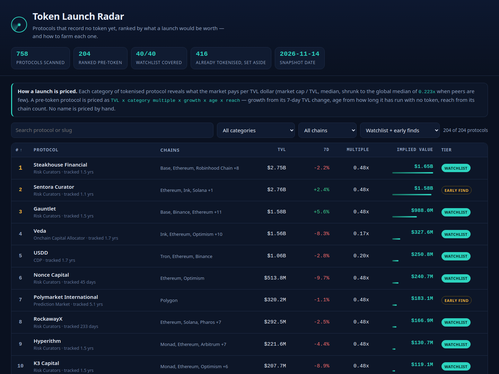
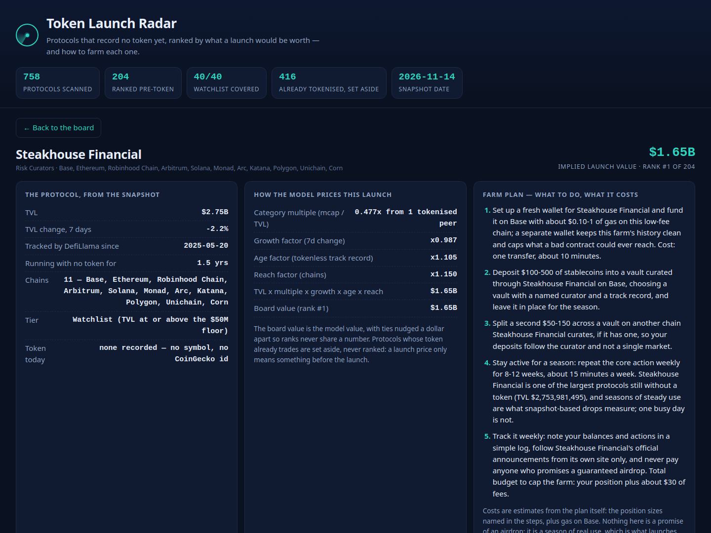

# 📡 Token Launch Radar — Token Valuation Model

A deterministic model that ranks **204 tokenised protocols** by implied value — built for the make.fun "Token Launch Radar" bounty ($1,325 pool). Passed all **15 / 15** kit checks with byte-identical reproducible runs.

## 📈 Leaderboard preview

## 🧠 Model
`implied value = TVL × category-median mcap/TVL`, where the multiple is:
- **winsorised** (outliers clipped) and **shrunk** toward the global median,
- adjusted for **7-day TVL growth**, **protocol age** and **chain reach**.

No randomness, no lookups at runtime: same snapshot in → same ranking out.

## 🗂️ Structure
| Path | What |
|---|---|
| `main.ts` | Entrypoint — loads the snapshot, runs the model, writes predictions |
| `lib/model.ts` | The valuation model |
| `dashboard/` | Static leaderboard UI — sortable board, protocol detail, category filter |

## 👤 Author
**Kamal Mosadegh** — freelance developer · [Portfolio](https://kamalmosadegh.github.io) · kamalmosadegh6977@gmail.com

MIT licensed.
